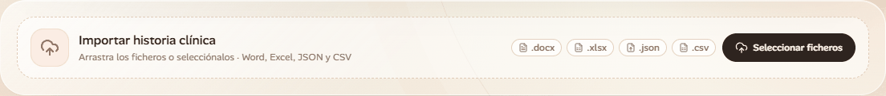
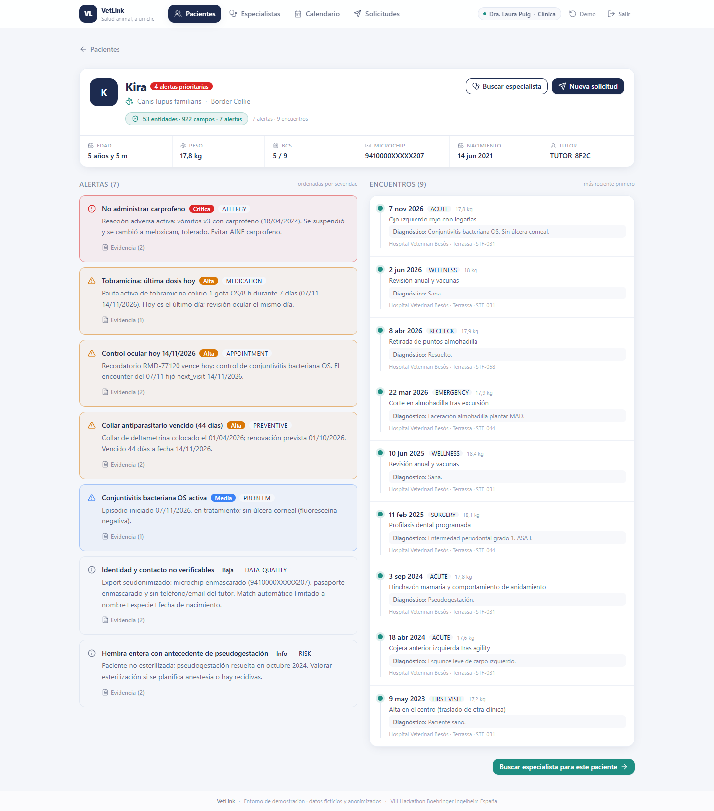
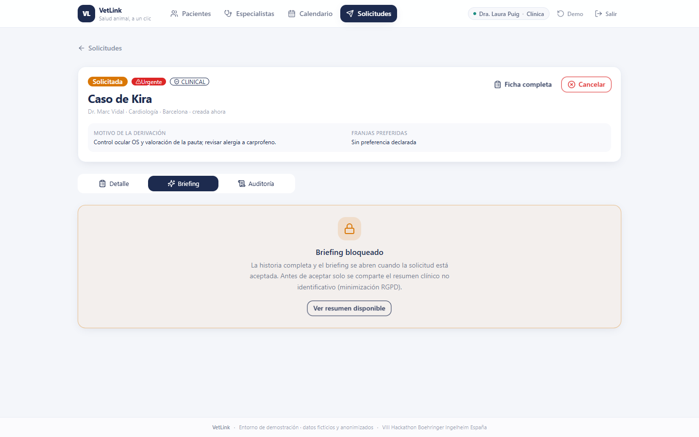
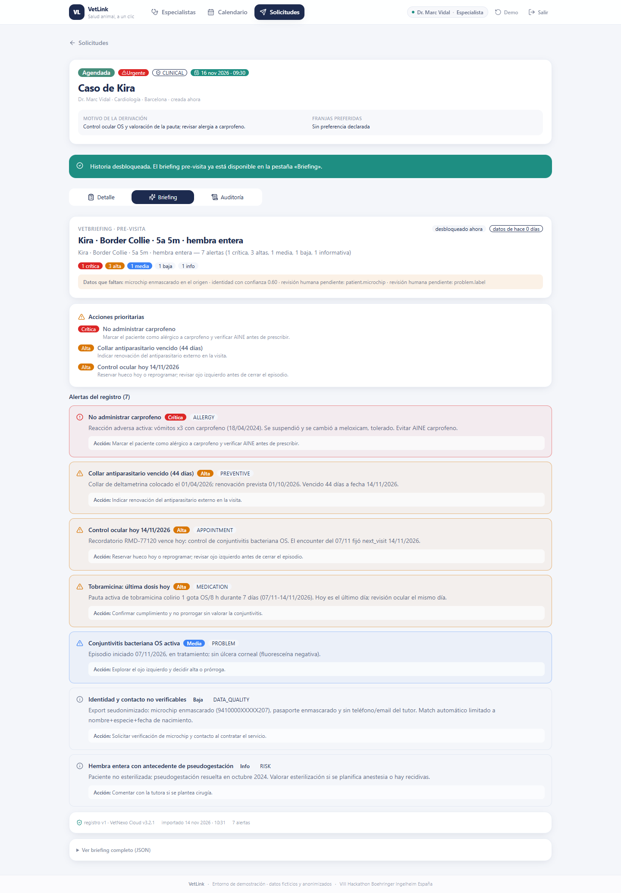
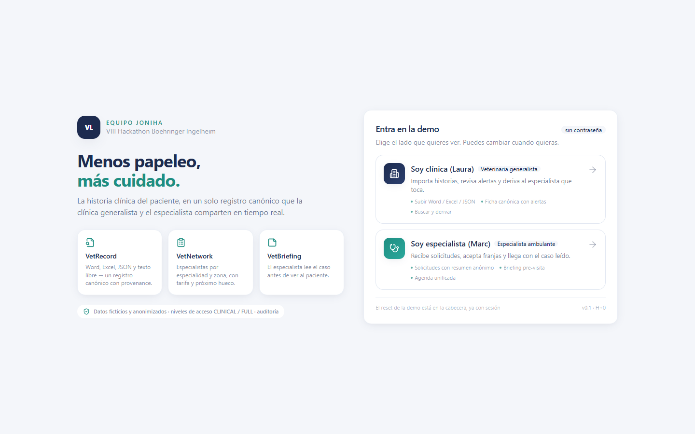
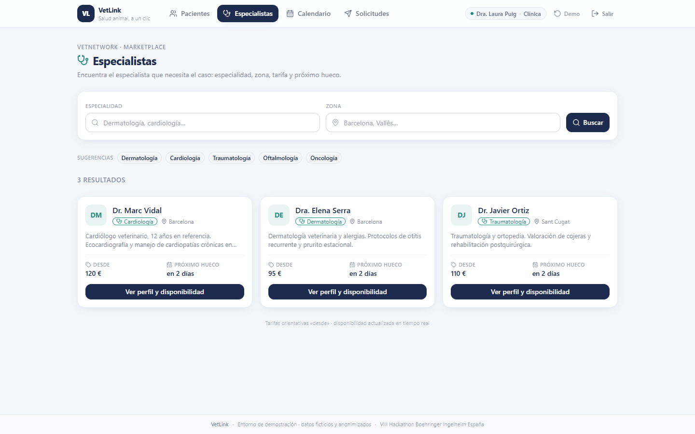
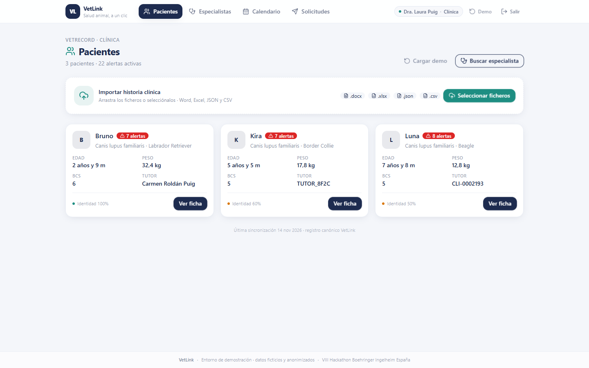
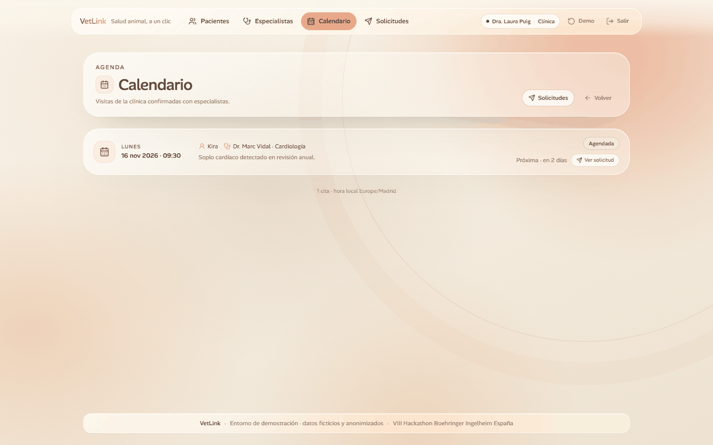
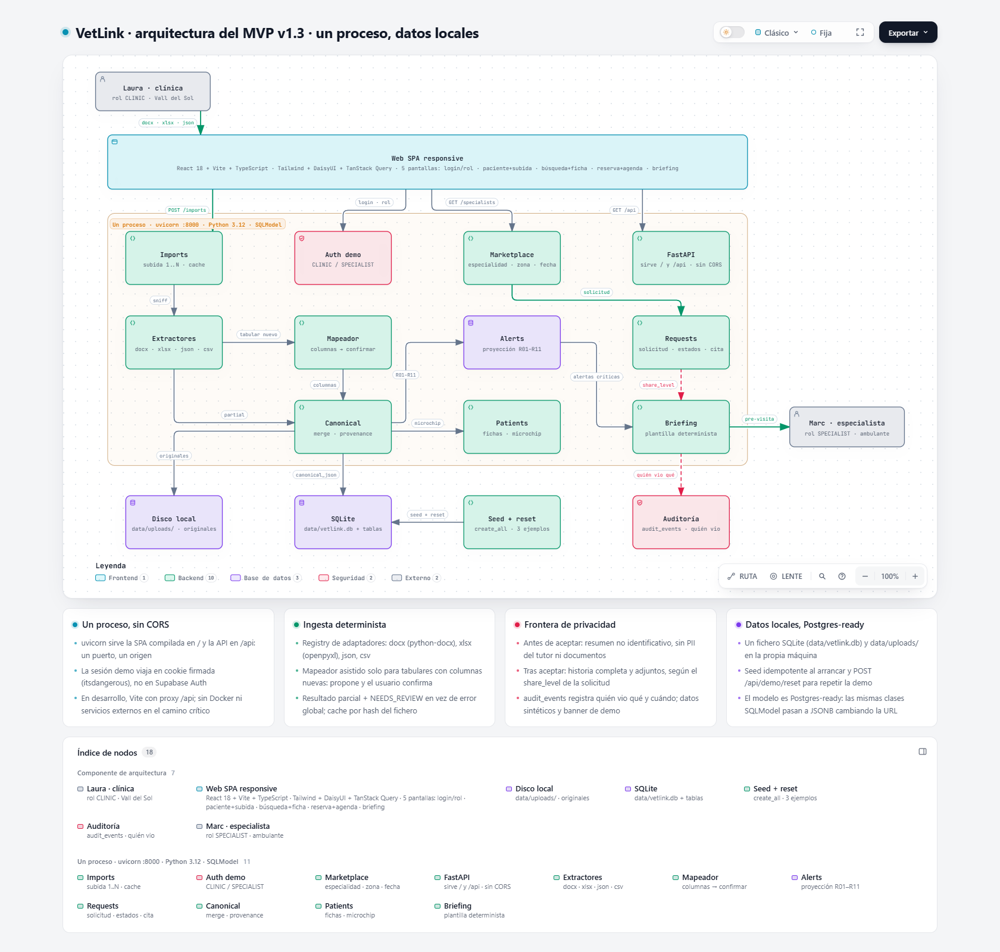
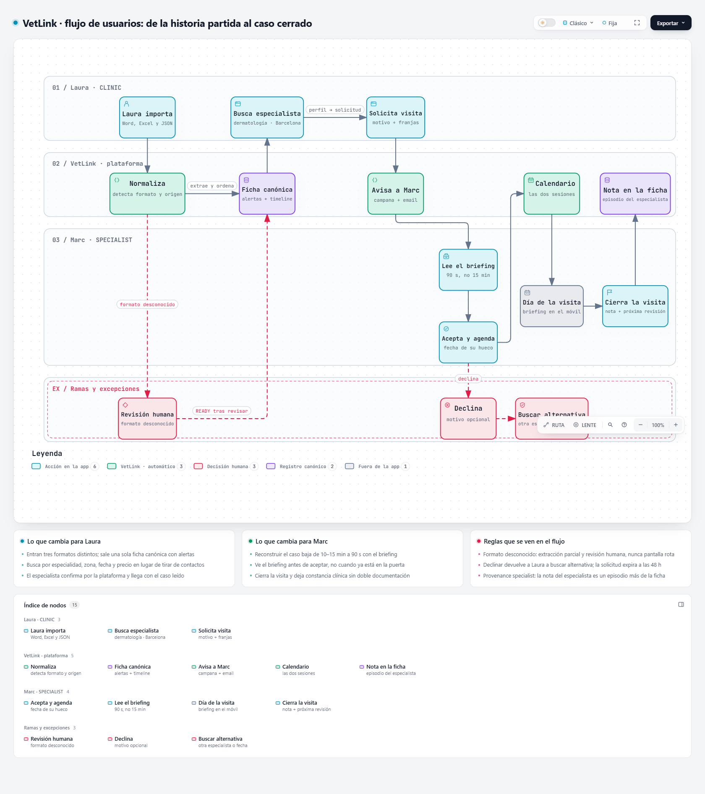

# VetLink · Salud animal, a un clic

> **Reto 3 — "Menos papeleo, más cuidado: los datos al servicio de la clínica"**  
> VIII Hackathon Boehringer Ingelheim España · 13–15 de noviembre de 2026 · Equipo **Joniha**

VetLink convierte el papeleo veterinario en **una historia clínica única y compartible**, conecta a la clínica generalista con el **especialista** que necesita y entrega al especialista un **briefing pre-visita** antes de ver al paciente.

## El problema

Laura es veterinaria generalista: no puede tener especialistas en plantilla y no sabe quién trabaja en su zona, qué ofrece, cuánto cuesta ni cuándo puede venir. Marc es especialista ambulante: cada clínica usa un software distinto y la historia del paciente le llega como Word, Excel, JSON o texto libre, incompleta y desordenada. Los primeros minutos de cada visita los dedica a reconstruir el caso. **La información existe, pero no llega a tiempo.**

## Capturas

| Importación multi-formato | Ficha clínica con alertas |
|---|---|
|  |  |

| Solicitud de derivación | Briefing pre-visita |
|---|---|
|  |  |

| Login por rol | Marketplace de especialistas | Pacientes | Agenda |
|---|---|---|---|
|  |  |  |  |

## Cómo funciona

1. **VetRecord · importación y normalización.** La clínica sube la historia en Word, Excel, JSON o CSV. La API la normaliza a un registro canónico único con procedencia por campo, confianza y alertas clínicas.
2. **VetNetwork · marketplace.** La clínica busca especialistas por especialidad y zona, ve su tarifa y disponibilidad, y solicita una derivación.
3. **VetBriefing · puente clínica ↔ especialista.** Antes de aceptar, el especialista ve un resumen no identificativo; al aceptar se desbloquean la historia completa y un briefing pre-visita determinista. Todo acceso queda auditado.

## Arquitectura y flujos

Un solo proceso FastAPI sirve la SPA y la API sobre SQLite y disco local; sin servicios externos en la demo.



Flujo completo de usuarios (clínica → VetLink → especialista):



## Stack

- **Frontend:** React 18 + Vite + TypeScript + Tailwind CSS + DaisyUI + React Router + TanStack Query.
- **Backend:** FastAPI + Pydantic + SQLModel.
- **Datos:** SQLite (demo) + documentos en disco. El modelo es portable a PostgreSQL.
- **Un solo proceso en demo:** FastAPI sirve la SPA compilada y la API en el mismo puerto, sin CORS ni servicios externos.

## Arranque rápido

Requisitos: **Python 3.11+**, **Node 20+** (con `npm`) y PowerShell en Windows.

### 1) Backend

```powershell
python -m venv services/api/.venv
services/api/.venv/Scripts/python.exe -m pip install -r services/api/requirements.txt

cd services/api
.venv\Scripts\python.exe -m uvicorn app.main:app --reload --port 8000
```

- API: `http://127.0.0.1:8000/api/health` · Swagger: `http://127.0.0.1:8000/docs`
- La base SQLite (`data/vetlink.db`) se crea y se rellena con los datos de demo al arrancar.

### 2) Frontend (desarrollo)

```powershell
cd apps/web
npm install
npm run dev
```

- SPA: `http://127.0.0.1:5173` (proxy `/api` → `:8000`).

### 3) Modo demo (un solo proceso, el que se presenta)

```powershell
cd apps/web
npm run build
cd ../services/api
.venv\Scripts\python.exe -m uvicorn app.main:app --port 8000
```

- Todo en `http://127.0.0.1:8000`.

### Atajos (PowerShell)

```powershell
powershell -File scripts\api.ps1     # API + SQLite + seed
powershell -File scripts\dev.ps1     # Vite dev
powershell -File scripts\demo.ps1    # compila la SPA y sirve todo en un proceso
powershell -File scripts\build.ps1   # compila la SPA
powershell -File scripts\stop.ps1    # libera los puertos de la demo
```

## Acceso a la demo

Login sin contraseña, con dos roles:

- **Laura (clínica):** importa historias, revisa alertas y solicita derivaciones.
- **Marc (especialista):** recibe solicitudes, acepta una franja y consulta el briefing pre-visita.

El botón **Cargar demo** (cabecera) reinicia los datos de ejemplo.

## Datos de ejemplo incluidos

En `data/samples/` hay tres historias reales del reto, anonimizadas, más un CSV con cabeceras no vistas para probar el mapeador:

| Fichero | Paciente | Origen |
|---|---|---|
| `Clínica Veterinaria Vall del Sol.docx` | Bruno | Ficha manual de clínica |
| `export_MAS-0004587_anonimizado.xlsx` | Luna | Exportación de PMS |
| `historial.json` | Kira | API VetNexo Cloud |
| `export_clinica_norte.csv` | Nala | Export de otra clínica (4º formato) |

## API

Contrato con 23 endpoints y documentación interactiva en **Swagger** (`/docs`). Un resumen por bloques:

- `auth`: login/logout demo por rol (`/api/auth/demo`, `/api/me`).
- `patients`: listado y ficha canónica (`/api/patients`, `/api/patients/{id}/record`).
- `imports`: subida multi-fichero y estado por fichero (`POST /api/imports`).
- `specialists`: marketplace y disponibilidad.
- `requests`: solicitud, resumen pre-aceptación, aceptación/declinación y briefing.
- `appointments` y `audit`: agenda y registro de accesos.
- `demo/reset`: reinicio de datos de ejemplo.

## Tests

```powershell
cd services/api
.venv\Scripts\python.exe -m ruff check app tests
.venv\Scripts\python.exe -m pytest -q

cd ../..
powershell -File scripts\e2e-api.ps1   # E2E de API (flujo completo, headless)
```

Puertas de calidad del proyecto: `ruff` sin avisos, `pytest` en verde, 0 comentarios/TODO en el código (`scripts\check-code.ps1`) y E2E de API con todas las comprobaciones en verde.

## Estructura

```
VetLink/
├── apps/web/              # SPA React + Vite + TypeScript + DaisyUI
├── services/api/          # FastAPI + SQLModel + SQLite (routers, seed, extractores)
├── data/
│   ├── samples/           # historias de ejemplo del reto + CSV
│   └── canonical/         # registros canónicos usados por el seed
├── contracts/             # contrato OpenAPI v1
├── screenshots/           # capturas de la demo y diagramas
├── scripts/               # atajos de arranque y verificación
└── README.md
```

## Privacidad

Todos los datos son **ficticios y anonimizados**. El prototipo aplica mínimo privilegio: roles, niveles de compartición (`CLINICAL` / `FULL`), resumen no identificativo antes de aceptar, auditoría de accesos y aviso visible de entorno de demostración. En producción: clínica como responsable del tratamiento, VetLink como encargado (DPA), alojamiento en la UE y consentimiento informado del tutor (RGPD / LOPDGDD).

## Equipo

Equipo **Joniha** · Jose Miguel (producto, frontend y demo) y Rayan (backend y datos).
Reto 3 de la VIII Hackathon de Boehringer Ingelheim España.
